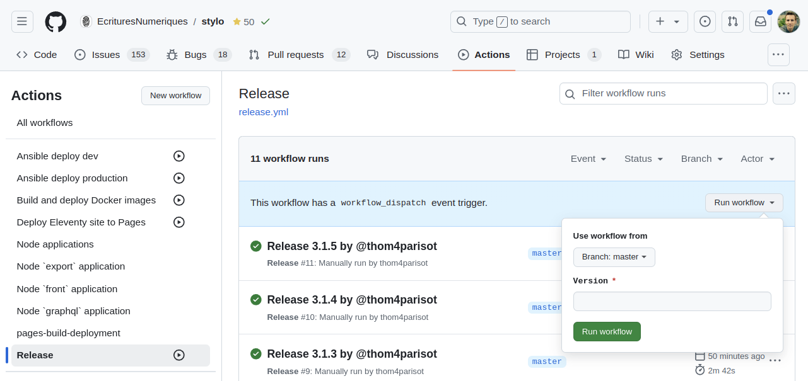
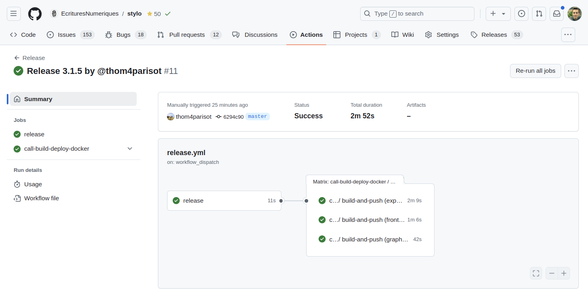
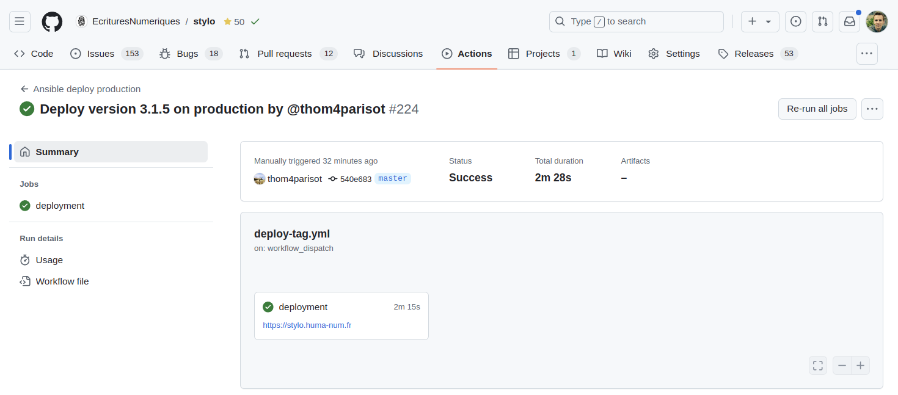
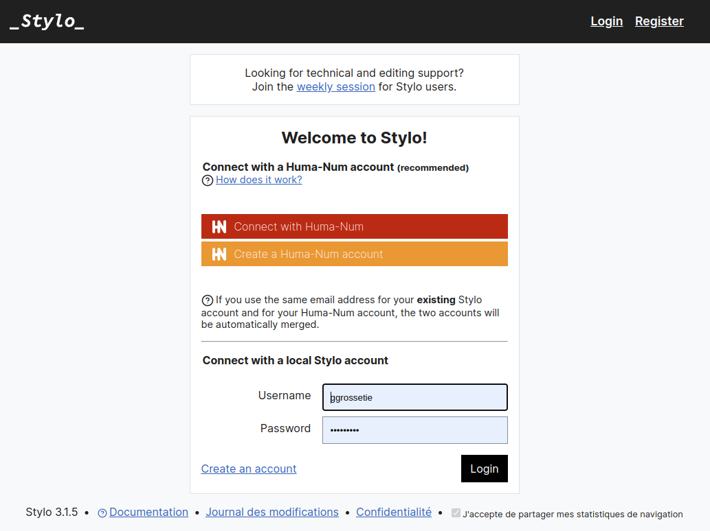

# Release

Cette page explique comment créer une nouvelle release de Stylo et comment la déployer sur https://stylo.huma-num.fr/.
Pour rappel, l'ensemble des changements qui arrivent sur la branche principale (i.e., `master`) sont déployés automatiquement sur https://stylo-dev.huma-num.fr/.

# Pré-requis

- Avoir un compte GitHub
- Avoir les droits d'écriture sur le projet GitHub [EcrituresNumeriques/stylo](https://github.com/EcrituresNumeriques/stylo)
- Avoir les droits de lancer le workflow [release](https://github.com/EcrituresNumeriques/stylo/actions/workflows/release.yml)

## Créer une nouvelle release

- Aller sur la page https://github.com/EcrituresNumeriques/stylo/actions/workflows/release.yml et cliquer sur le bouton "Run workflow".
- Une fenêtre s'ouvre et propose de renseigner une branche, un numéro de version et s'il faut déployer en production à la suite (case « Trigger deploy? », cochée par défaut) :
  

- Laisser la branche principale (i.e., `master`) sélectionnée et renseigner une version (sans suffixe).
  Par exemple : `3.4.5`.
- Décocher « Trigger deploy? » si vous ne souhaitez pas déployer cette version en production tout de suite.
- Cliquer sur le bouton vert "Run workflow"

Une nouvelle ligne va s'afficher dans la liste. Vous pouvez voir le détail en cliquant sur la ligne : 

Le workflow se compose de trois étapes :
- release
  - modifie la version dans les fichiers `package.json` de la racine et des workspaces `front` et `graphql`
  - met à jour le fichier `package-lock.json` (unique, à la racine du dépôt)
  - commit les changements
  - crée un tag à partir de la version renseignée lors du lancement du workflow
- call-build-deploy-docker
  - construit et déploie les images Docker sur le registre ghcr.io
    - https://github.com/EcrituresNumeriques/stylo/pkgs/container/stylo-graphql
    - https://github.com/EcrituresNumeriques/stylo/pkgs/container/stylo-front
- call-deploy-prod (uniquement si « Trigger deploy? » est cochée)
  - déploie la version sur https://stylo.huma-num.fr/ (voir [Déployer une version en production](#déployer-une-version-en-production))

> [!NOTE]
> Les deux dernières étapes peuvent être lancées manuellement puisqu'elles reposent sur les workflows [docker](https://github.com/EcrituresNumeriques/stylo/actions/workflows/docker.yml) et [deploy](https://github.com/EcrituresNumeriques/stylo/actions/workflows/deploy-tag.yml).

Une fois ce workflow terminé, vous devriez avoir une nouvelle version des images Docker dans le registre ghcr.io et, si le déploiement était demandé, la nouvelle version en production.

## Déployer une version en production

Par défaut, le workflow de release déploie la nouvelle version en production.
Cette section décrit comment déployer une version manuellement, par exemple si la case « Trigger deploy? » a été décochée ou pour redéployer une version précédente.

> [!NOTE]
> Assurez-vous que les images Docker `stylo-graphql` et `stylo-front` de cette version sont disponibles sur le registre ghcr.io.
> Le service d'export repose sur l'image `davidbgk/stylo-export`, dont la version est fixée par la variable `stylo_export_version` des inventaires Ansible ([`infrastructure/inventories`](infrastructure/inventories)).

Une fois la version des images disponibles sur ghcr.io, vous pouvez lancer le workflow [deploy](https://github.com/EcrituresNumeriques/stylo/actions/workflows/deploy-tag.yml).
De la même façon que pour le workflow de release, cliquer sur le bouton "Run workflow".  
Laisser la branche principale (i.e., `master`) sélectionnée et renseigner la version à déployer (sans suffixe). Par exemple : `3.4.5`.  

Une nouvelle ligne va s'afficher dans la liste. Vous pouvez voir le détail en cliquant sur la ligne : 

Une fois le déploiement terminé en succès, vous pouvez vous rendre sur https://stylo.huma-num.fr/ afin de vérifier que la version est bien déployée.
Le numéro de version s'affiche dans le pied de page :

Ici, la version déployée est la version 3.1.5.
